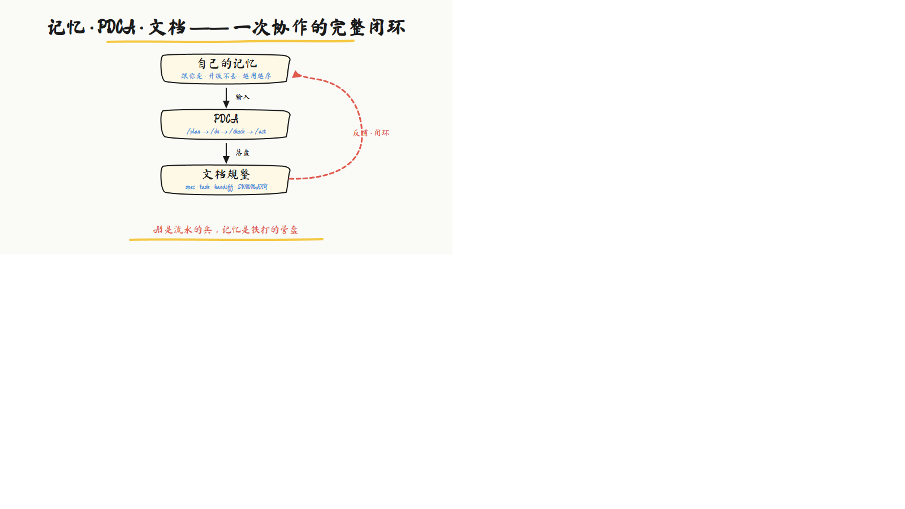

<div align="center">

[](LICENSE)
[](HISTORY.md)
[](#安装详解)


# pdca-skill

**把管理学的 PDCA，装进每一次 AI 协作**

AI 是流水的兵，记忆是铁打的营盘  
先问清再动手 · 改崩了能回退 · 聊完记得住

[30 秒上手](#30-秒上手) · [产品页](网页说明.html) · [两大核心](#两大核心定位) · [安装详解](#安装详解) · [更新日志](HISTORY.md)

</div>

---

## 两大核心定位

pdca-skill 不是「又一个 skill 合集」。它解决 AI 协作里最致命的两件事：

### 1. 自己的记忆 —— 跟你走，不跟工具走

| 痛点 | 有 pdca-skill 之后 |
|------|-------------------|
| 换模型、换客户端，上次约定全没了 | **三层记忆**：热记忆（框架）+ 全局聚合记忆 + 项目记忆 |
| 升级 skill 包把数据覆盖没了 | **用户数据外置**到 `~/.pdca-skill/data/`，升级框架 **0 丢失** |
| AI 聊着聊着「失忆」 | 每段实质工作 **写入即落盘**，跨对话可恢复 |
| 经验散落在聊天记录里 | 踩过的坑、定过的规矩，沉淀成**跟你本人的个人资产** |

> 一句话：**AI 是流水的兵，记忆是铁打的营盘。**

### 2. 文档规整 —— 聊完就散 → 可追溯、可交接

| 痛点 | 有 pdca-skill 之后 |
|------|-------------------|
| 做完一地聊天记录，新人接不上 | 自动落 **spec（方案）/ task（清单）/ handoff（交接）** |
| 项目文件乱、版本对不齐 | **SUMMARY 根索引** + **sync-matrix 一致性核对** |
| 不知道做到哪了 | task 逐项打勾；交接时 **4 闸门证据** 才能说「完成」 |
| 文档格式各写各的 | **12 个模板** + `generate_docs.py` 一键生成规范结构 |

> 一句话：**把 AI 协作从「聊完就散」升级成工程化交付。**

这两大核心由 **PDCA 四环**串起来：`/plan` 想清楚 → `/do` 动手做 → `/check` 验结果 → `/act` 写记忆 + 交文档。`/act` 的产出就是下一轮 `/plan` 的输入——**闭环**。

---

## 没有它 / 有它

| 没有 pdca-skill | 有 pdca-skill |
|----------------|---------------|
| 没问清就写代码，做偏了返工 | **HARD-GATE**：方案确认后才动手 |
| 改崩了找不到上一版 | **回溯保障**：改前检查点，能回退 |
| 聊着聊着忘了约定 | **自己的记忆**跨对话接着干 |
| 做完一地文件，没法交接 | **文档规整**：spec / task / handoff 自动落盘 |
| 每个 AI 各干各的，经验不沉淀 | 经验进记忆，**跟人不跟工具** |

---

## 长什么样

<p align="center">
  
</p>

（手绘闭环图；源 SVG 为 `assets/readme/hero-loop.svg`，PNG 为浏览器渲染版——Gitee 对 .svg 的 MIME 适配有误，README 统一引用 PNG 保证两端平台显示一致）

---

## 四个产品卖点

| # | 卖点 | 你得到什么 |
|---|------|-----------|
| 1 | **自己的记忆** | 三层记忆 + 数据外置；换工具、升级包，资产还在 |
| 2 | **文档规整** | 方案/清单/交接自动生成；一致性核对；可交接可复盘 |
| 3 | **四指令调度一切** | 记住 `/plan` `/do` `/check` `/act` 即可调度全部能力；`/loop` 可自动循环执行 |
| 4 | **7 条铁律** | Memory First、HARD-GATE、不给半成品、改前可回退……AI 不能凭印象乱来 |

进阶能力（对抗审查、副 agent、技能图谱、活人感写作/去AI味、文件扫描门控等）见下方 [完整能力地图](#完整能力地图)。

---

## 30 秒上手

1. **安装**：把 `pdca-skill/` 整个目录复制到 AI 编程助手的 skills 目录  
2. **开聊**：新对话自动加载；首次会引导 Bootstrap（并创建 `~/.pdca-skill/data/`）  
3. **正常说话**：简单事直接做；复杂事说 **`/plan`** 走四环；收尾说 **整理一下 / 交接** 走文档规整  

更细的验证命令、数据路径、可选 API Key → [安装详解](#安装详解)。

---

## 目录

- [两大核心定位](#两大核心定位)
- [没有它 / 有它](#没有它--有它)
- [四个产品卖点](#四个产品卖点)
- [30 秒上手](#30-秒上手)
- [它是什么 / 不是什么](#它是什么--不是什么)
- [一天里的真实例子](#一天里的真实例子)
- [工作原理](#工作原理)
- [完整能力地图](#完整能力地图)
- [参考手册（47 模块）](#参考手册references-47-个按需读取模块)
- [模板文件（12 个）](#模板文件assets-12-个开箱即用)
- [安装详解](#安装详解)
- [可选配置](#可选配置项)
- [目录结构](#目录结构)
- [迭代与质量](#迭代与质量)
- [许可证](#许可证)

---

## 它是什么 / 不是什么

| ✅ 它是 | ❌ 它不是 |
|--------|----------|
| **自己的记忆系统** + **文档规整方法** + 跨任务硬规则 | 把几十个技能塞进体内的大杂烩 |
| **技能编排器**：按触发词读手册 / 调度外部专业 skill | 自带画图、Excel、爬虫的万能工具箱 |
| 纯本地 Markdown + Python 标准库脚本，零云依赖 | 必须联网/开账号才能跑的在线服务 |

> 包内：**48** 个参考模块 · **12** 个模板 · **34** 个脚本 · **0** 个独立子技能目录。专业能力通过钩子去外部搜索调度。

**装前 2 个前提**：

1. **它得跑在能调用大模型的 AI 助手上**（如 WorkBuddy）。框架是「规矩」，模型是「脑子」——内网完全离线跑需要内网版模型。
2. **框架本身零云依赖、纯本地文件**：不联网、不调外部 API。内网部署 = 把整个目录拷贝过去即可。（画图/爬虫等具体活靠外部专业技能，那些技能各自可能有云依赖，不传染框架。）

---

## 一天里的真实例子

你说：「帮我写个用户登录功能。」

| 没有框架 | 有 pdca-skill |
|---------|---------------|
| 直接噼里啪啦写代码 | **先澄清**（密码还是验证码？要记住登录吗？） |
| 风格随缘、安全随缘 | **读规矩**（`code_rules` / `security`） |
| 改崩了难回退 | **改前检查点**，能回退 |
| 聊完只剩聊天记录 | **落文档**：spec + task + handoff |
| 下次重开又失忆 | **写记忆**，约定还在 |

你感受到的差别：先问清再干、干得有规矩、出事能回退、事后有文档和记忆。

---

## 工作原理

```text
/plan  想清楚（读记忆 + 澄清 + 方案 + HARD-GATE）
  ↓
/do    动手做（按 task 逐项；写代码前读 code_rules）
  ↓
/check 验结果（对照 spec + 对抗审查 + 证据闸门）
  ↓
/act   处理动作（写记忆 + 刷 SUMMARY + 交接整理）
  ↓
下一轮 /plan 再读记忆与文档 → 闭环
```

- **记忆**：每次 `/act` 写入 = 下次 `/plan` 输入  
- **文档**：spec/task/handoff 是物质载体，让协作可追溯、可交接  
- **PDCA**：统一调度中枢；`/loop` 是 `/do`+`/check` 的自动循环开关  

更完整的产品叙事见 [网页说明.html](网页说明.html)。

---

## 完整能力地图

| 能力 | 说明 |
|------|------|
| **自己的记忆（三层）** | 热记忆（SKILL+references）· 全局 `memory_main.md` · 项目 `docs_rj/memory_rj/`；`write_project` 写入即落盘并 upsert 全局 |
| **文档规整** | spec/task/handoff 三件套 · SUMMARY 根索引 · sync-matrix 版本与引用核对 · `generate_docs` / `handoff_tidy` / `startup_tidy` · 交接 4 闸门证据 |
| **用户数据外置** | 数据在 `~/.pdca-skill/data/`，升级框架不丢记忆与文档 |
| **PDCA 四环** | `/plan` `/do` `/check` `/act`；`/loop` 自动循环；用户只需记 4 个词 |
| **7 条铁律** | Memory First · HARD-GATE · 流程优先 · No Placeholders · 触发钩子 · 回溯保障 · 逐项核对 |
| **第一性原理拆解** | 复杂方案前三问：本质目标 / 不可压缩约束 / 从约束推最优解 |
| **对抗性审查** | 独立 subagent 6 维度审查，HIGH/MEDIUM/LOW，最多 3 轮 |
| **安全 HIGH 特殊处理** | 注入/越权等独立流程，X/Y 双计数器 |
| **命名空间隔离** | `_rj` 后缀，避免与其他 agent 平台撞名 |
| **Bootstrap** | 首次使用检测缺失并引导创建 |
| **Git 回溯保障** | 改前检查点、任务级回溯、紧急回滚 SOP |
| **agent-find** | 外部能力搜索（Exa → WebFetch → WebSearch 降级链） |
| **Red Flags** | 19 条偏离信号自检 |
| **手绘呈现** | 验收/汇报 → 手绘 SVG 速记 |
| **HTML/PPT 制作** | 做网页/落地页 → 手写 HTML/CSS/JS（前端设计五原则）；做 PPT → python-pptx / PptxGenJS 生成可编辑 .pptx 或 HTML 幻灯片；自包含方法论见 `html_ppt_creation.md`（内网可用） |
| **活人感写作** | 写文章/知乎/去AI味等 13 触发词 → 直接出稿 + `check_prose.py` |
| **文件扫描门控** | L0 任务内 / L1 点名文件 / L2 任务外须确认（防误扫敏感目录） |
| **技能图谱** | 能力画像；点名全量先确认；`/act` 自动刷新仅读框架自身记忆 |

> 🔴 **隐私声明（v1.0.1）**：技能图谱（master_graph）会扫描本机 AI 工具记忆目录（`~/.claude`、`~/.cursor`、`%APPDATA%` 等）生成能力画像。**用户点名/手动全量触发时，运行前会先向你确认**；其中 8 个固定 AI 工具记忆目录属功能核心，**启用该功能即视为授权**、不重复确认（见 skill_graph.md §4）。扫描发现的敏感文件内容**不会被引用、转述或持久化**（敏感行摘录自动过滤）。**每轮 /act 自动刷新（--auto）仅读框架自身记忆**（L0 免确认），不扫外目录，记忆未变化时零成本跳过。其余功能均只读写框架自身目录与 `~/.pdca-skill/data/`，零云依赖。

---

## 参考手册（references/）—— 49 个按需读取模块

不全部加载到上下文，触发钩子按「你正在做什么」自动指引读取。按使用场景分 8 类：

**① 写代码 / 改代码时**

| 文件 | 用途 |
|------|------|
| [code_rules.md](references/do/code/code_rules.md) | 代码风格/结构/错误处理/测试/API/数据库/安全规范 |
| [design_patterns.md](references/plan/design/design_patterns.md) | 6 种设计模式应用指南 |
| [project_structure.md](references/plan/design/project_structure.md) | 标准项目结构/模块划分/配置管理 |
| [git_workflow.md](references/do/code/git_workflow.md) | Git 分支策略/Commit 规范/回溯保障/回滚 SOP |
| [html_ppt_creation.md](references/do/code/html_ppt_creation.md) | 做 HTML 网页/落地页 → 手写 HTML/CSS/JS；做 PPT → python-pptx/PptxGenJS 可编辑 .pptx 或 HTML 幻灯片（自包含、内网可用） |

**② 出错 / 调试时**

| 文件 | 用途 |
|------|------|
| [debugging.md](references/common/dc/debugging.md) | 报错时的四步调试法 |
| [red_flags.md](references/check/red_flags.md) | 19 条偏离信号 + 理性化反驳 |

**③ 写文档 / 出报告时**

| 文件 | 用途 |
|------|------|
| [document_specs.md](references/common/pda/document_specs.md) | 文档命名/格式/多 docs 目录处理规范 |
| [hand-drawn-report.md](references/common/da/hand-drawn-report.md) | 手绘呈现（内容→手绘 SVG 速记/信息图） |

**④ 安全 / 合规时**

| 文件 | 用途 |
|------|------|
| [security.md](references/do/danger/security.md) | 安全边界 + 指令优先级 + 注入防御 + **文件扫描确认门控**（L0/L1/L2） |
| [skill_security.md](references/plan/route/skill_security.md) | 第三方 skill 安全审计规范 |

**⑤ 记忆 / 交接 / 多项目时**（对应两大核心）

| 文件 | 用途 |
|------|------|
| [working_memory_rules.md](references/common/pa/working_memory_rules.md) | 记忆读写/归档/跨对话恢复 |
| [summary_view.md](references/common/pa/summary_view.md) | SUMMARY_RJ.md 根索引 + 漂移检查 |
| [sync-matrix.md](references/common/da/sync-matrix.md) | 变更影响矩阵 + 版本号一致性（文档规整入口） |
| [multi_project.md](references/plan/bootstrap/multi_project.md) | 多项目切换/隔离 |
| [compaction_recovery.md](references/plan/bootstrap/compaction_recovery.md) | 上下文压缩恢复协议 |

**⑥ 要找外部专业能力时**

| 文件 | 用途 |
|------|------|
| [browser_automation.md](references/do/code/browser_automation.md) | 浏览器操控/自动化 |
| [agent_find.md](references/plan/route/agent_find.md) | 第三方 agent/能力 搜索安装验证 |
| [skill_management.md](references/plan/route/skill_management.md) | Skill 搜索→安装→验证→安全扫描 |
| [skill_creation.md](references/plan/route/skill_creation.md) | 建/改/测自建 Skill（意图捕获→四件套→测试迭代） |

**⑦ 初始化 / 审查 / 示范时**

| 文件 | 用途 |
|------|------|
| [bootstrap.md](references/plan/bootstrap/bootstrap.md) | 引导式初始化 |
| [adversarial_review.md](references/common/pc/adversarial_review.md) | 第一性原理 + 对抗性审查 |
| [communication_rules.md](references/common/dc/communication_rules.md) | 沟通原则 + 文件变动声明 |
| [usage_examples.md](references/plan/route/usage_examples.md) | 3 段真实对话演示 |

**⑧ 写文章 / 长文时**

| 文件 | 用途 |
|------|------|
| [article-writing.md](references/common/style/article-writing.md) | 活人感写作入口（知乎/公众号/去AI味等；直接出稿；材料澄清最多三问） |

> 上表按场景收录 25 个高频模块；全量 49 个模块索引见 [references/index.md](references/index.md)。

## 模板文件（assets/）—— 12 个开箱即用

spec / task / handoff / memory / memory_bootstrap / daily_log / summary / archive / market_research / spec_main / skill_graph / index 十二类模板，配合 `generate_docs.py` 自动生成——**文档规整的物质基础**。

---

## 安装详解

### 方式一：复制到 skills 目录

将 `pdca-skill/` 整个目录复制到你的 AI 编程助手的 skills 目录下即可。

### 用户数据外置（重要）

pdca-skill 采用**用户数据外置方案**：你的记忆、文档、输出等数据放在 `~/.pdca-skill/data/`（与框架文件物理分离），**不在 skill 包内**。

**为什么这样设计**：每次发布新版 skill 包，你只需解压覆盖框架文件，**用户数据 0 丢失**——再也不用担心升级覆盖丢数据。

**数据目录结构**（首次启动自动创建）：

```
~/.pdca-skill/
├── config.json              # 路径配置（可选，不存在则用默认值）
└── data/
    ├── memory/              # 全局聚合记忆（memory_main.md）
    ├── docs_rj/             # 项目文档（spec/task/handoff/memory）
    │   ├── memory_rj/
    │   ├── spec_rj/
    │   ├── task_rj/
    │   └── SUMMARY_RJ.md
    ├── outputs_rj/          # 输出产物
    └── server_lite_data/    # 框架自动创建的占位目录（server_lite 数据，当前不主动引导使用）
```

**三级优先级路径解析**（从高到低）：

1. **环境变量** `PDCA_DATA_DIR`（临时覆盖，如 `set PDCA_DATA_DIR=D:\my-pdca-data`）
2. **配置文件** `~/.pdca-skill/config.json` 的 `data_dir` 字段（持久化自定义路径）
3. **默认值** `~/.pdca-skill/data/`（推荐，零配置）

**老用户升级**：如果你之前用的是包内数据（旧版本），首次启动新版会**自动迁移**包内数据到外置目录，迁移成功后包内的旧数据目录可安全删除。迁移是原子操作（复制成功才删除源），支持并发锁（防多实例冲突），7 天回滚窗口。

**server_lite 说明**：server_lite（日积面板）是已完整实现但不主动引导使用的可选组件——功能与 AI 对话定位重叠，当前版本不再引导用户启动。代码保留供未来扩展或用户主动启用，如需使用：`python run_server.py` 启动后访问 http://127.0.0.1:5210。`server_lite_data/` 目录由框架自动创建作为占位，即使不启用 server_lite 也无负面影响。

### 首次使用

第一次对话时，框架会自动检测缺失文件并引导 Bootstrap 初始化（同时自动创建外置数据目录 `~/.pdca-skill/data/`），按提示确认创建即可。

### 验证安装

完成目录复制后，建议在 `pdca-skill/` 项目根目录（包含 `SKILL.md` 的目录）下运行以下命令，确认安装完整、脚本可执行。所有命令仅使用 Python 标准库，无第三方依赖（测试套件需要 pytest）。

#### 环境前置检查

| 项 | 要求 | 检查命令 |
|----|------|---------|
| Python 版本 | 3.9 及以上 | `python --version` |
| 操作系统 | Windows / macOS / Linux 均可 | — |
| 当前目录 | 必须在 `pdca-skill/` 项目根 | Windows：`cd`（无参数）；macOS/Linux：`pwd` |
| pytest（仅测试验证需要） | 任意现代版本 | `python -m pytest --version` |

检查 Python 版本：

```bash
python --version
```

预期输出：

```text
Python 3.9.x  或更高版本（如 Python 3.10.x / 3.11.x / 3.12.x）
```

> Windows 用户用 `python`；macOS/Linux 用户若默认 `python` 指向 Python 2，请改用 `python3`。

#### 基础验证命令

以下 5 条命令覆盖核心脚本，在项目根执行。**成功标志：退出码 0 且汇总行显示"失败 0"**。

**① 项目结构守卫 — startup_tidy**

```bash
python scripts/startup_tidy.py --dry-run
```

预期输出（stdout 输出 JSON 报告，stderr 输出日志）：

```text
{
  "mode": "dry-run",
  "status": "ok",
  ...
}
```

- 成功标志：退出码 0；JSON 中 `status` 字段为 `"ok"`；无 `[BLOCKER]` 级别问题
- `[WARN]` 级别警告（如归档类提示）可忽略
- 若报 `[BLOCKER] SUMMARY_RJ.md 缺失`，加 `--create-summary` 参数引导创建

**② 技能验证 — validate_skill**

```bash
python scripts/validate_skill.py
```

预期输出（关键标志）：

```text
[SCR-01] ... : PASS
[SCR-02] ... : PASS
...
全部检查通过 (N/N)
```

- 成功标志：退出码 0；末尾汇总"全部检查通过"；所有 `[SCR-XX]` 项均为 `PASS`
- 检查范围：scripts/ 完整性、references/ 引用、generate_docs.py 可调用性等

**③ 全局文件验证 — validate_global_files**

```bash
python scripts/validate_global_files.py
```

预期输出（关键标志）：

```text
共 N 文件 / 验证 N / 通过 N / 失败 0
```

- 成功标志：退出码 0；汇总行 `失败 0`
- 检查范围：SKILL.md / README.md / HISTORY.md / memory/memory_main.md / protocol/*.py 等全局关键文件的存在性与格式

**④ 路由检查 — route_check**

```bash
python scripts/route_check.py
```

预期输出（关键标志）：

```text
共 N 条 / 通过 N / 失败 0
```

- 成功标志：退出码 0；汇总行 `失败 0`
- 默认检查脚本上级目录（即仓库根）；如需指定其他目录，加 `--skill-dir <路径>`
- 检查范围：触发钩子表、references 索引、`protocol/routing.py` 路由层一致性

> ⚠️ 本脚本不支持位置参数（不要写 `route_check.py .`），默认即检查仓库根目录。

**⑤ 协议对齐 — protocol_align**

```bash
python scripts/protocol_align.py
```

预期输出（关键标志）：

```text
共 N 条 / 通过 N / 失败 0
```

- 成功标志：退出码 0；汇总行 `失败 0`
- 检查范围：`protocol/` 包常量与 SKILL.md / references 的字段约定对齐

#### 测试验证

运行 pytest 测试套件（覆盖负向测试 + 协议对齐 + 扫描确认门控 + 技能图谱修复 + 交接 4 闸门，共 202 个测试用例，201 passed + 1 skipped，详见 HISTORY.md 2026-08-06）：

```bash
python -m pytest tests/ -v
```

预期输出（关键标志）：

```text
========================= test session starts =========================
platform ... -- Python 3.9.x, pytest-x.x.x, ...
rootdir: .../pdca-skill, configfile: tests/pytest.ini
collected 202 items

tests/test_negative_cases.py::test_no_circular_imports PASSED                [  5%]
tests/test_negative_cases.py::test_no_personal_paths PASSED                  [ 11%]
tests/test_negative_cases.py::test_no_dead_references PASSED                 [ 17%]
tests/test_negative_cases.py::test_protocol_importable_without_errors PASSED [ 23%]
tests/test_protocol_align.py::test_extract_traceability_sources_returns_valid_dict PASSED [ 29%]
tests/test_protocol_align.py::test_extract_traceability_sources_handles_missing_docstring PASSED [ 35%]
tests/test_protocol_align.py::test_check_alignment_returns_correct_structure PASSED [ 41%]
...（参数化测试用例，共 202 项）
========================= 201 passed, 1 skipped in ~30s ==========================
```

- 成功标志：退出码 0；末尾 `201 passed, 1 skipped`；无新增 `FAILED` 字样
- 实际耗时与版本号会因环境而异，关键看 `passed` 数量与退出码

> Windows 用户也可一键运行：`tests\run_tests.cmd`（等价于 `python -m pytest tests/ -v`）。

#### 当前版本已知状态

当前版本 `validate_skill.py` 32/32 项通过（FAIL=0，MUST FIX=0），pytest 测试套件 202 项中 201 项通过 + 1 skipped，无本版本引入的已知失败项。

#### 故障排查

| 现象 | 可能原因 | 解决方案 |
|------|---------|---------|
| `python: command not found` | Python 未安装或未加入 PATH | 安装 Python 3.9+ 并勾选 "Add to PATH"；macOS/Linux 用 `python3` |
| `ModuleNotFoundError: No module named 'pytest'` | 未安装 pytest | `python -m pip install pytest` |
| `can't open file 'scripts/xxx.py'` | 当前目录不对 | `cd` 到 `pdca-skill/` 项目根再执行（须包含 `SKILL.md` 和 `scripts/`） |
| `startup_tidy` 报 `[BLOCKER] SUMMARY_RJ.md 缺失` | 项目首次使用未初始化 | `python scripts/startup_tidy.py --dry-run --create-summary` 引导创建 |
| `startup_tidy` 输出乱码或 JSON 解析失败 | Windows 控制台编码问题 | 执行 `chcp 65001` 切换为 UTF-8；或改用 PowerShell 7+ |
| `validate_skill` 报 SCR-10 缺少版本号引用块 | 部分 `references/*.md` 未补版本号标记 | 属已知待办，可忽略；或手工在文件头部补版本号引用块 |
| `validate_global_files` 全部失败 | 项目根路径检测异常或核心文件缺失 | 确认在项目根执行；重新完整复制 `pdca-skill/` 目录 |
| `route_check` 报 `unrecognized arguments: .` | 误传了位置参数 | 本脚本不支持位置参数，去掉 `.`；默认检查仓库根；如需指定目录用 `--skill-dir <路径>` |
| `route_check` 报 `protocol/routing.py 不存在` | protocol/ 包缺失 | 重新完整复制 `pdca-skill/protocol/` 目录 |
| pytest 报 `configfile: pytest.ini not found` | 当前目录不对 | `cd` 到项目根；`tests/pytest.ini` 会自动加载 |
| pytest 报 `No module named 'protocol'` | protocol/ 包未正确复制 | 确认 `protocol/__init__.py` 存在；重新复制 `protocol/` 目录 |
| 中文输出乱码 | Windows 控制台编码问题 | `chcp 65001` 切换 UTF-8，或改用 PowerShell；重定向到文件时用 `Out-File -Encoding utf8` |

通过以上全部验证（或仅核心命令通过 + pytest 201 项全过）后，即可确认 pdca-skill 安装完整、可正常使用。下一步可回到上方 [30 秒上手](#30-秒上手) 开始第一次对话。

## 可选配置项

pdca-skill **默认零配置即可运行**——所有外部搜索能力都有降级链（API 不可用时退回 WebSearch）。但配置以下任一项，对应能力会从"降级模式"升级到"完整模式"。

**配置总览**：

| # | 配置项 | 用途 | 不配的后果 | 配置难度 |
|---|--------|------|-----------|---------|
| 1 | `EXA_API_KEY` | Exa REST API 全网语义搜索（`agent-find` 钩子用） | 退回 WebSearch 兜底，精准度下降 | ⭐⭐ 简单 |
| 2 | `GITHUB_TOKEN` | `find_similar.py` 搜 GitHub 仓库（`/plan` 步骤 4a.3 用） | API 限流 60次/小时，常返回 0 条 | ⭐⭐ 简单 |
| 3 | `GITEE_TOKEN` | `find_similar.py` 搜 Gitee 仓库（`/plan` 步骤 4a.3 用） | API 限流较紧，常返回 0 条 | ⭐⭐ 简单 |
| 4 | `PDCA_DATA_DIR` | 用户数据外置路径覆盖（默认 `~/.pdca-skill/data/`） | 用默认路径，无影响 | ⭐ 极简 |

> **建议**：① Exa（最常用，全网搜索）→ ② GitHub Token（搜代码仓库）→ ③ Gitee Token（国内源）→ ④ PDCA_DATA_DIR（仅自定义路径才配）。**全部可选，按需配**。
>
> **此外还有 3 项运行时配置**（非环境变量，是脚本参数/文件字段，见下方 ⑤ 运行时配置（可选）章节）：`find_similar.py` 命令行参数、server_lite 端口、`/loop` 最大迭代次数。默认值都能跑，仅调整行为时才改。

---

### ① 配置 Exa 搜索（`EXA_API_KEY`）

**用途**：`agent-find` 能力（找 skill / 找 agent / 找工具 / 找 MCP server / 查开源项目）默认优先走 **Exa REST API 直连**做全网语义搜索，精准度远高于普通搜索引擎。不配则降级走 WebSearch。

**两种配置方式（任选其一）**：

#### 方式 A：环境变量（推荐，跨平台）

1. 去 [dashboard.exa.ai](https://dashboard.exa.ai) 注册账号 → 申请 API Key（免费额度足够日常使用）
2. 复制 key（格式类似 `xxxx-xxxx-xxxx-xxxx`）
3. 设置环境变量：

| 平台 | 命令 |
|------|------|
| **Windows（永久）** | PowerShell：`[System.Environment]::SetEnvironmentVariable("EXA_API_KEY", "你的key", "User")` |
| **Windows（临时）** | CMD：`set EXA_API_KEY=你的key` |
| **macOS / Linux** | `echo 'export EXA_API_KEY="你的key"' >> ~/.bashrc && source ~/.bashrc`（zsh 用户改 `~/.zshrc`） |

4. **重开终端**后生效

#### 方式 B：`exa.env.json` 文件（项目本地）

1. 复制模板：`cp exa.env.json.example exa.env.json`
2. 编辑 `exa.env.json`，把 `YOUR_EXA_API_KEY_HERE` 换成你的 key：

```json
{
  "EXA_API_KEY": "你的真实key"
}
```

3. **确认 `.gitignore` 已包含 `exa.env.json`**（防止误提交到 git）：

```bash
# 在项目根运行，应输出 exa.env.json
grep "exa.env.json" .gitignore
```

> 脚本会自动探测多个候选位置：当前目录 / `../` / `../../` / `~/.agent/skills/pdca-skill/` / `~/.workbuddy/skills/pdca-skill/`，都找不到再退回环境变量。

#### 验证

```bash
# 设置后新开终端，运行（应能正常返回搜索结果 JSON）
python -c "import os; print('EXA_API_KEY 已设置' if os.environ.get('EXA_API_KEY') else '未设置')"
```

#### Exa MCP（可选上层，无需 key）

若你的客户端**已配置 Exa MCP**（OAuth 免 key），可改用 MCP 工具 `web_search_exa` / `web_fetch_exa`，省去读 key 步骤。配置：

```json
{
  "mcpServers": {
    "exa": { "url": "https://mcp.exa.ai/mcp" }
  }
}
```

首次连接时在浏览器登录一次即可使用。**与 REST API 是两套独立鉴权体系**（MCP 走 OAuth，REST 用 `x-api-key` 头），二者选其一。

#### 安全注意

- ❌ **不要提交到 git**：`exa.env.json` 必须在 `.gitignore` 中
- ❌ **不要打包进分发的 zip**：`package_skill.py` 已自动排除
- ❌ **不要复用他人 key**：每个用户申请自己的
- ✅ **定期更换**：建议 90 天到期重新生成
- ✅ **泄露处理**：立即去 [dashboard.exa.ai](https://dashboard.exa.ai) 撤销并重新生成

---

### ② 配置 GitHub Token（`GITHUB_TOKEN`）

**用途**：`/plan` 步骤 4a.3 跑 `python scripts/find_similar.py scan` 搜 GitHub 仓库时用。不配 → 限流 60次/小时（约1次/分钟），常被限返回 0 条；配了 → 5000次/小时，稳定返回真实结果。

**获取步骤**：

1. 浏览器打开 https://github.com/settings/tokens?type=beta （Fine-grained，官方推荐）
2. 点 **Generate new token** → **Generate new fine-grained token**
3. 填写：
   - **Token name**：`find-similar-pdca-skill`
   - **Expiration**：90 天（到期再生成）
   - **Repository access**：选 **Public Repositories (read-only)**（只读公共仓库，最小权限）
   - **Permissions**：保持默认（搜索 API 不需要额外权限）
4. 点 **Generate token** → **立即复制**（只显示一次！格式类似 `github_pat_xxxx...`）

**设置环境变量**：

| 平台 | 命令 |
|------|------|
| **Windows（永久）** | PowerShell：`[System.Environment]::SetEnvironmentVariable("GITHUB_TOKEN", "github_pat_xxxx", "User")` |
| **Windows（临时）** | CMD：`set GITHUB_TOKEN=github_pat_xxxx` |
| **macOS / Linux** | `echo 'export GITHUB_TOKEN="github_pat_xxxx"' >> ~/.bashrc && source ~/.bashrc` |

**验证**：

```bash
# 重开终端后运行
python scripts/find_similar.py scan --task "PDF解析" --keywords "PDF,解析" --min-stars 5
# 看到 "[find_similar] 搜索 GitHub... -> N 条结果"（N>0）即生效
```

**安全注意**：

- ❌ **不要提交到 git**：token 只存环境变量，不写进任何文件
- ✅ **最小权限**：只勾 `Public Repositories (read-only)`，不要勾 `repo` 全权限
- ✅ **定期更换**：90 天到期重新生成
- ✅ **泄露处理**：立即去 https://github.com/settings/tokens 撤销（Revoke）

---

### ③ 配置 Gitee Token（`GITEE_TOKEN`）

**用途**：`/plan` 步骤 4a.3 跑 `find_similar.py scan` 搜 Gitee 仓库（国内 skill 源）时用。不配 → 限流较紧常返回 0 条；配了 → 稳定返回结果。

**获取步骤**：

1. 浏览器打开 https://gitee.com/profile/personal_access_tokens
2. 点 **生成新令牌**
3. 填写：
   - **名称**：`find-similar-pdca-skill`
   - **有效期**：90 天
   - **权限**：只勾 `projects`（仓库读取，最小权限）
4. 点 **提交** → **立即复制**（格式类似 `xxxxxxxxxxxxxxxxxxxx`）

**设置环境变量**：

| 平台 | 命令 |
|------|------|
| **Windows（永久）** | PowerShell：`[System.Environment]::SetEnvironmentVariable("GITEE_TOKEN", "gitee_xxxx", "User")` |
| **Windows（临时）** | CMD：`set GITEE_TOKEN=gitee_xxxx` |
| **macOS / Linux** | `echo 'export GITEE_TOKEN="gitee_xxxx"' >> ~/.bashrc && source ~/.bashrc` |

**验证**：

```bash
# 重开终端后运行
python scripts/find_similar.py scan --task "PDF解析" --keywords "PDF,解析" --min-stars 5
# 看到 "[find_similar] 搜索 Gitee... -> N 条结果"（N>0）即生效
```

**安全注意**：

- ❌ **不要提交到 git**：token 只存环境变量
- ✅ **最小权限**：只勾 `projects`，不要勾 `user_info` / `emails` 等
- ✅ **定期更换**：90 天到期重新生成
- ✅ **泄露处理**：立即去 https://gitee.com/profile/personal_access_tokens 撤销

---

### ④ 配置用户数据路径（`PDCA_DATA_DIR`，可选）

**用途**：覆盖默认用户数据路径 `~/.pdca-skill/data/`。仅在你想把数据放到其他位置（如 D 盘、移动硬盘、网络盘）时才配。**不配 = 用默认路径，无任何影响**。

**三级优先级**（从高到低）：

1. **环境变量** `PDCA_DATA_DIR`（临时覆盖）
2. **配置文件** `~/.pdca-skill/config.json` 的 `data_dir` 字段（持久化自定义路径）
3. **默认值** `~/.pdca-skill/data/`（推荐，零配置）

**设置环境变量（临时覆盖）**：

| 平台 | 命令 |
|------|------|
| **Windows** | CMD：`set PDCA_DATA_DIR=D:\my-pdca-data` |
| **macOS / Linux** | `export PDCA_DATA_DIR=/path/to/my-pdca-data` |

**持久化配置（推荐）**：

编辑 `~/.pdca-skill/config.json`（不存在则创建）：

```json
{
  "data_dir": "D:/my-pdca-data"
}
```

> 路径分隔符：Windows 用 `/` 或 `\\`（不要用单个 `\`，JSON 会转义错）。

**验证**：

```bash
python -c "from scripts.user_data_path import get_user_data_dir; print(get_user_data_dir())"
# 输出你配置的路径即生效
```

**安全注意**：

- ✅ **路径权限**：确保目标路径当前用户有读写权限
- ✅ **不要指向网络盘根目录**：建议指向网络盘下的子目录（如 `Z:/pdca-data/`，不要直接 `Z:/`）
- ✅ **跨平台路径**：Windows 用 `/` 或 `\\`，macOS/Linux 用 `/`

---

### ⑤ 运行时配置（可选）

以下配置不是环境变量，而是脚本命令行参数或文件内字段，**不配也能用默认值跑**，仅在你需要调整行为时改。

#### 5.1 `find_similar.py` 命令行参数

`/plan` 步骤 4a.3 跑外部资源搜索时用的脚本，配了 `GITHUB_TOKEN` / `GITEE_TOKEN` 后才会真正返回结果。

**`scan` 子命令参数**：

| 参数 | 必填 | 默认 | 说明 |
|------|------|------|------|
| `--task` | ✅ 是 | — | 任务描述（写入输出文件名，如 `PDF解析`） |
| `--keywords` | ❌ 否 | 从 `--task` 自动提取 | 搜索关键词，逗号分隔（如 `PDF,解析`） |
| `--min-stars` | ❌ 否 | `5` | 最低 star 数过滤（GitHub/Gitee） |
| `--max-age-days` | ❌ 否 | `365` | 最后更新在 N 天内才算（过滤老项目） |
| `--output` | ❌ 否 | 自动 | 输出 JSON 路径（默认 `docs_rj/spec_rj/find_similar_{task}_{时间戳}.json`） |

**示例**：

```bash
# 最简用法（--keywords 从 --task 自动提取）
python scripts/find_similar.py scan --task "PDF解析"

# 自定义关键词 + 过滤条件
python scripts/find_similar.py scan --task "PDF解析" --keywords "PDF,解析" --min-stars 10 --max-age-days 365

# 列出所有配置的搜索源（无需参数）
python scripts/find_similar.py list
```

> 不配 token 也能跑，但 GitHub/Gitee API 限流常返回 0 条；配了 token 才稳定返回真实结果。

#### 5.2 server_lite 端口（PORT=5210）

server_lite（本地看板）默认端口 **5210**，启动后访问 http://127.0.0.1:5210。

**改端口方法**（两种，任选其一）：

| 方式 | 操作 | 说明 |
|------|------|------|
| 改配置文件（推荐） | 编辑 `server_lite/config.py` 第 35 行：`PORT = 5200` | 改一次永久生效，所有启动方式都用这个端口 |
| 改入口脚本 | 编辑 `run_server.py` 第 11 行的 `5210` 数字：`app.run(host="127.0.0.1", port=app.config.get('PORT', 5200), debug=True)` | 仅影响 `python run_server.py` 启动方式；若 config.py 也改了，以 config.py 为准 |

> server_lite 当前为可选组件（不主动引导使用），不启动它就无需关心这个端口。

#### 5.3 `/loop` 最大迭代次数（`max_iterations: 10`）

`/loop` 自动循环模式默认最多迭代 10 次后熔断停下。复杂任务可调高，简单任务可调低。

**配置位置**：在任务 spec.md 文件的 front-matter（顶部 YAML 区块）：

```yaml
---
title: 复杂任务 - 需求规格说明
version: v1.0.0
max_iterations: 15  # 复杂任务调高（默认 10）
---
```

**取值规则**：
- **类型必须 int**：拒绝 bool / 字符串 / 浮点数（`"10"` / `10.0` 都不行）
- **最小值 1**：低于 1 会被拒
- **建议范围**：
  - 简单任务：5-8（快速熔断，避免瞎试）
  - 默认：10
  - 复杂任务：15-20（给足空间，但仍有限制防无限循环）

> 不写这个字段 = 用默认值 10。详见 [references/loop_constraints.md](references/do/danger/loop_constraints.md)。

---

### 配置项快速排查

如果配了 token 但 `find_similar.py` 仍返回 0 条，按以下顺序排查：

| 现象 | 可能原因 | 解决方案 |
|------|---------|---------|
| `python -c "import os; print(os.environ.get('GITHUB_TOKEN'))"` 输出 `None` | 环境变量未生效 | 重开终端；或检查是否设成了 `Machine` 级但当前用户无权读 |
| `find_similar.py` 报 `401 Unauthorized` | token 失效或错误 | 去 GitHub/Gitee 设置页重新生成 |
| `find_similar.py` 报 `403 Forbidden` | token 权限不足 | 检查 token 权限（GitHub 选 `Public Repositories (read-only)`，Gitee 勾 `projects`） |
| `find_similar.py` 报 `Connection timeout` | 网络不通 | 检查代理/VPN；GitHub 在国内可能需要梯子 |
| Exa 搜索返回空 | key 配置错或额度用完 | 去 [dashboard.exa.ai](https://dashboard.exa.ai) 检查额度；或换 `exa.env.json` 方式重试 |
| `exa.env.json` 被误提交到 git | `.gitignore` 未配置 | `git rm --cached exa.env.json` + 确认 `.gitignore` 含 `exa.env.json` |

> **降级保证**：以上配置**全部不配**也不影响框架核心功能——所有外部搜索都有 WebSearch 兜底，所有用户数据都有默认路径。配置只是"从降级模式升级到完整模式"。

## 目录结构

```
pdca-skill/
├── SKILL.md                    # 主入口文件，每次对话自动加载（含 7 铁律 / HARD-GATE / 触发钩子表）
├── README.md                   # 本文件
├── HISTORY.md                  # 版本历史
├── 网页说明.html               # 项目落地页（介绍页，README 顶部"产品页"链接指向此文件）
├── run_server.py               # server_lite 启动脚本（可选组件，当前不主动引导使用）
├── exa.env.json.example        # Exa API Key 配置模板（复制为 exa.env.json 后填 key）
├── .gitignore
├── .primary_docs_rj            # 主 docs 目录标记
├── assets/                     # 12 个模板文件
│   ├── spec_template.md
│   ├── spec_main_template.md
│   ├── task_template.md
│   ├── handoff_template.md
│   ├── memory_template.md
│   ├── memory_bootstrap_template.md
│   ├── daily_log_template.md
│   ├── summary_template.md
│   ├── archive_template.md
│   ├── market_research_template.md
│   ├── skill_graph_template.md
│   ├── index_template.md
│   └── readme/                     # README 配图（hero-loop.svg 手绘闭环图）
├── references/                 # 49 个参考手册（按需读取，见上表）
├── scripts/                    # Python 脚本（协作框架核心 + 用户数据外置 + loop 守卫，共 34 个）
│   ├── archive_tidy.py
│   ├── browser_inspect_docs.py      # 文档浏览器检视辅助
│   ├── check_prose.py               # 文章成稿检查（硬禁词/冒号/破折号/翻案句，见 article-writing）
│   ├── check_skill_updates.py
│   ├── commit_lint.py               # Git commit 信息校验
│   ├── commit_lint_install.py       # commit_lint 安装脚本
│   ├── devlog_sync.py
│   ├── find_similar.py              # 外部资源搜索（/plan 步骤 4a.3 用，搜 GitHub/Gitee/国内平台）
│   ├── generate_docs.py
│   ├── generate_host_rules.py
│   ├── git_backup_tidy.py
│   ├── handoff_tidy.py
│   ├── launch_subagent_rj.py
│   ├── learn_tidy.py
│   ├── link_indexer.py
│   ├── loop_admission.py
│   ├── loop_audit.py
│   ├── loop_guard.py
│   ├── memory_distill.py            # 记忆蒸馏/精炼
│   ├── memory_shadow_write.py
│   ├── migrate_user_data.py         # 用户数据迁移（老用户升级自动迁移）
│   ├── package_skill.py             # 发布打包脚本（排除用户数据目录）
│   ├── protocol_align.py
│   ├── route_check.py
│   ├── skill_graph_build.py
│   ├── skill_graph_cluster.py
│   ├── skill_graph_extract.py
│   ├── skill_graph_render.py
│   ├── startup_tidy.py
│   ├── test_loop_admission.py
│   ├── tidy_common.py
│   ├── user_data_path.py            # 三级优先级路径解析 + 安全检测
│   ├── validate_global_files.py
│   └── validate_skill.py
├── server_lite/                # 本地 Web 界面（可选组件，已实现但不主动引导使用）
│   ├── static/                 # 前端文件（index.html/app.js/style.css）
│   ├── tests/                  # server_lite 测试套件（保留，见 server_lite/tests/README.md）
│   ├── api_settings.py         # 数据管理 API（路径查看/修改/迁移）
│   ├── api_knowledge.py
│   ├── api_skills.py
│   ├── api_docs.py
│   ├── app.py
│   └── ...
├── protocol/                   # 文件协议层（字段契约/路由/校验）
├── tests/                      # 测试套件（pytest，202 项）
├── docs_rj/                    # 项目文档（外置后实际在 ~/.pdca-skill/data/docs_rj/）
├── memory/                     # 全局聚合记忆（外置后实际在 ~/.pdca-skill/data/memory/）
├── outputs_rj/                 # 输出产物（外置后实际在 ~/.pdca-skill/data/outputs_rj/）
├── agents_rj/                  # 副 agent 配置
└── evals/
    └── evals.json              # 典型场景测试用例集
```

> **注意**：`docs_rj/`、`memory/`、`outputs_rj/` 在打包发布时会自动排除（由 `package_skill.py` 处理），用户安装后这些目录实际位于 `~/.pdca-skill/data/` 下。本地开发环境保留这些目录作为骨架和示例。

## 迭代与质量

本框架历经多轮迭代。关键保障：

- **21 轮**独立 subagent 对抗性审查；HIGH 曾连续 4 轮清零
- **pytest** 202 项（201 passed + 1 skipped）；`validate_skill.py` **32/32** MUST FIX=0
- 交接 **4 闸门证据驱动**；文件扫描确认门控；技能图谱数据外置

详细里程碑与变更见 [HISTORY.md](HISTORY.md)。

## 许可证

[非商业源码可得许可证 v1.0](LICENSE)

- **个人学习、研究等非商业用途**：免费使用、修改、分享，须保留本许可证与版权声明
- **任何商业用途**（出售、作为收费产品/服务的实质组成部分等）：须事先获得作者书面授权
- 商业授权请联系作者 **huihui**